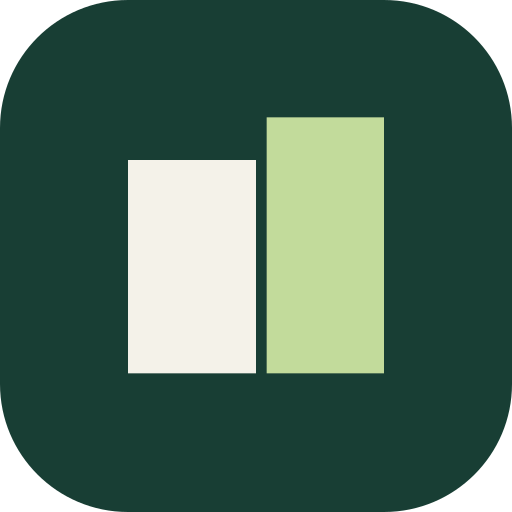

<p align="center"></p>

# micloud

**A self-hosted mirror of everything in your iCloud account, on storage you own.**

micloud runs on an always-on Mac that is signed into your Apple account and keeps a second copy
of your photos, files, mail, contacts, calendars, reminders, notes, bookmarks, messages and
health data on your own Nextcloud, with photos optionally fanned out to Immich as well. If the
Apple account is ever locked, closed or unreachable, nothing of value is lost.

It is one-way by design. micloud reads from iCloud and writes to your server. It never writes
back to Apple, and deletes on the target are soft (a dated trash folder), so a mistake on the
phone cannot wipe the copy.

Website and guides: https://getmicloud.com

## What is in this repository

| Path | What it is |
|---|---|
| `app/micloud/` | The macOS app. A SwiftUI dashboard plus the always-on relay that watches each source and uploads changes as they happen. |
| `app/ios/` | The iPhone companion. Pairs with the Mac, shows the mirror status, and archives Apple Health to the same server (Health never reaches a Mac, so the phone has to send it). |
| `app/MicloudKit/` | The shared Swift package: configuration, the sync-source contract, the backfill engine and ledger, WebDAV and Immich clients, licence verification, telemetry. Builds with the Command Line Tools alone. |
| `app/probes/` | The small sandbox experiments that proved each capability before it went into the app. |
| `agent/` | The original script-based agent (Python and shell, launchd). It is the reference spec the native app replaced and is still useful to read. |
| `docs/` | Design notes, including the thin-cache delta engine and the privacy and key handling. |
| `monitoring/` | Grafana and Loki staleness alerts and a dashboard for an instance. |
| `packaging/` | Developer ID signing and notarisation helpers for the non-App-Store build. |

## How it works

```
Apple iCloud
    │  a Mac you own, signed into the account
    ▼
micloud (macOS)  ── PhotoKit · FSEvents · EventKit · Contacts · Mail store · Messages ──►  change seen
    │                                                                               fetch → upload → evict
    ├─ Photos & videos      → Nextcloud and/or Immich
    ├─ iCloud Drive / Documents → Nextcloud
    ├─ Calendars, Contacts, Reminders → Nextcloud (CalDAV / CardDAV)
    ├─ Notes, Safari bookmarks, Messages, Mail → Nextcloud
    └─ Health                → Nextcloud (sent by the iPhone companion)
```

The Mac does not keep a full local copy. Each lane materialises only the item that changed,
long enough to upload it, then lets macOS evict it again. A small-disk Mac mini can mirror a
multi-terabyte account. A backfill engine walks the existing library once, with a ledger so it
can resume after any interruption, and the dashboard shows counts that match what the source
holds right now.

## Status

micloud is in daily production for its first operator and in TestFlight for others. The
dashboard, every lane listed above, the backfill of existing libraries and the iPhone Health
archive are all live. It is not yet in the App Store, so today you build it from source.

Expect rough edges around first-run setup. Open an issue when you hit one.

## Download (macOS)

Grab the latest `micloud-<version>.zip` from the
[Releases page](https://github.com/mineracks/micloud/releases). It is Developer ID signed and
notarised, so unzip it, drag `micloud.app` to Applications and open it. The first run asks for
the Photos, Calendars, Contacts and Reminders permissions it needs, and the Notes, Safari,
Messages and Mail lanes also need Full Disk Access (System Settings, Privacy & Security).

The Messages lane renders your history with [imessage-exporter](https://github.com/ReagentX/imessage-exporter),
which is GPL-3.0 and therefore not bundled. Install it with `brew install imessage-exporter`
and the lane picks it up from `/opt/homebrew/bin`.

The iPhone companion, which also archives Apple Health, is not on the App Store yet. Build it
from source with your own Apple developer team: see [`app/ios/README.md`](app/ios/README.md).

## Building from source

You need macOS with Xcode's Command Line Tools (Swift 6), a Nextcloud server, and optionally an
Immich server. Full Xcode is only needed for App Store packaging.

```bash
# the shared core and its smoke test
cd app/MicloudKit && swift build && swift run Smoke

# the macOS app (ad-hoc signed, sandboxed)
cd app/micloud && ./build.sh && ./run.sh

# the iPhone companion for the Simulator
cd app/ios && ./build-ios.sh
```

`app/micloud/SIGNING.md` covers Developer ID signing and notarisation, `app/micloud/release.sh`
produces the notarised download zip, and `app/micloud/configure.sh` points an installed app at
your servers. The iPhone companion has its own [`README`](app/ios/README.md).

## Privacy

Nothing leaves the Mac except uploads to the servers you configure. There is no telemetry to
mineracks, no account, and no phone-home. The optional Pro tier is an offline Ed25519 token
checked against a public key embedded in `License.swift`. See `docs/design/privacy-and-keys.md`.

## Hosted option

If you would rather not run a Mac yourself, mineracks offers micloud as a managed service with
the same open-source app, so you can take over the setup at any time. Details at
https://getmicloud.com. The provisioning for that service is not part of this repository.

## Contributing

Issues and pull requests are welcome. Keep changes one-way (never write to iCloud), keep deletes
soft, and keep counts honest: a tile should never claim more than the source holds.

## Licence

Apache License 2.0. See `LICENSE`.

"micloud" and the micloud logo are trade marks of Mineracks Pty Ltd. The licence does not grant
permission to use them, other than to describe the origin of the software. micloud is not
affiliated with or endorsed by Apple Inc. iCloud is a trade mark of Apple Inc.
